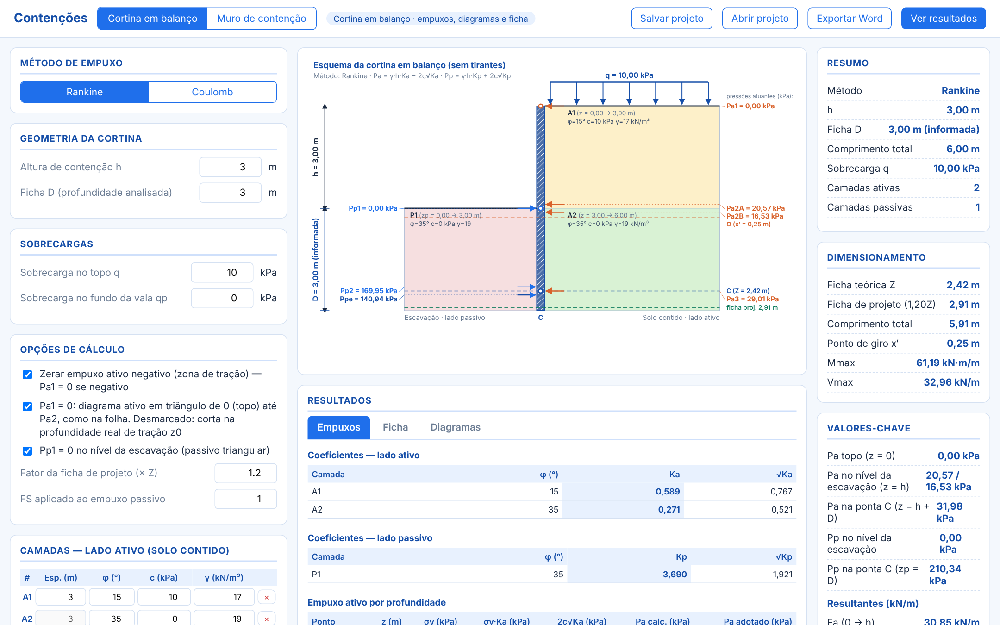
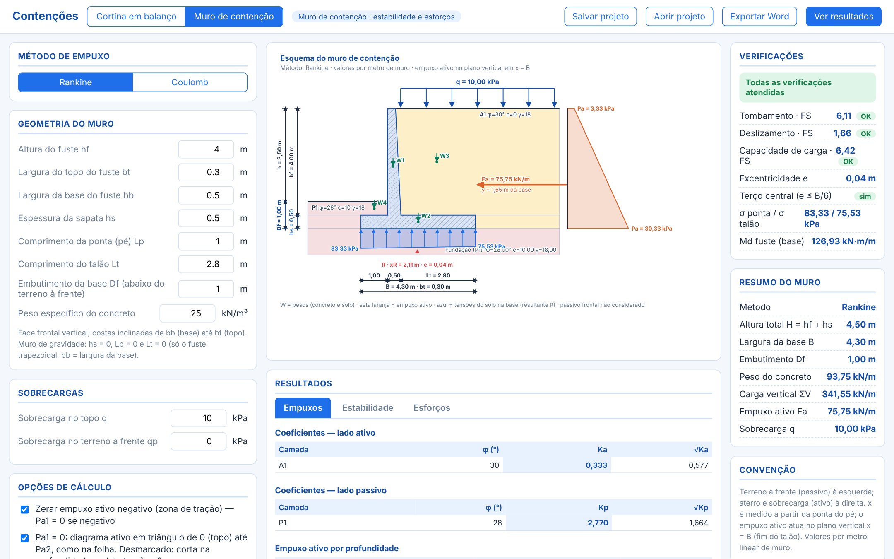
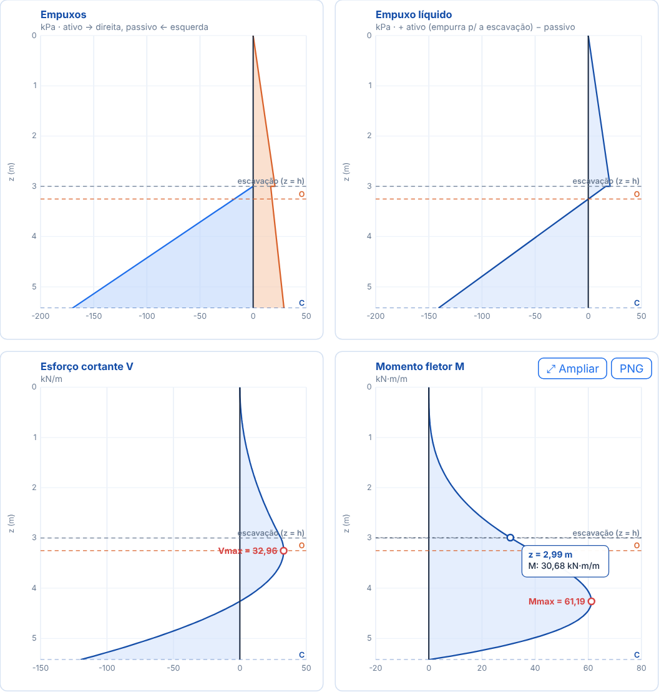

# Contenções

App de engenharia geotécnica para **empuxos de terra**, **ficha de cortina em balanço** e **muros de contenção** (gravidade e flexão).

É um único arquivo HTML: abre com duplo clique no navegador, sem instalar nada e sem internet.



## Como usar

1. Baixe o `index.html` (ou o repositório inteiro, em **Code → Download ZIP**).
2. Abra o `index.html` no Chrome, Edge ou Firefox.
3. Escolha o modo no topo: **Cortina em balanço** ou **Muro de contenção**.
4. Informe o método (Rankine ou Coulomb), a geometria, as sobrecargas e as camadas de solo do lado ativo e do passivo (espessura, φ, c, γ).
5. Os resultados atualizam na hora. Use **Salvar projeto** / **Abrir projeto** para guardar em `.json` e **Exportar Word** para gerar a memória de cálculo.

Exemplos prontos para abrir estão na pasta [`exemplos/`](exemplos).

## O que o app faz

### Empuxos
- Ka e Kp por **Rankine** ou **Coulomb** (δ e β), por camada.
- Tensões ativas e passivas com coesão: `Pa = σv·Ka − 2c√Ka` e `Pp = σv·Kp + 2c√Kp`.
- Sobrecarga no topo e no lado passivo; tratamento da zona de tração.

### Cortina em balanço (sem tirantes)
- Ficha pelo método da folha de cálculo: ponto de giro x′, equilíbrio de momentos na ponta C (E1·y1 + E2·y2 − E3·y3 = 0), Z = x + x′ e ficha de projeto = 1,2·Z (fator editável).
- Fator de segurança opcional no empuxo passivo.
- Diagramas de empuxo, empuxo líquido, cortante e momento fletor, com Mmax e Vmax.
- Pontos Pa1, Pa2A, Pa2B, Pa3, Pp1, Pp2 e Ppe marcados no esquema.

### Muro de contenção
- Muro de gravidade ou de flexão (fuste, sapata, ponta e talão).
- Tombamento, deslizamento, tensões na base (terço central) e capacidade de carga (Meyerhof ou Vesic).
- Esforços no fuste, na ponta e no talão, com valores de cálculo (× γf).



### Diagramas interativos
- Passe o mouse para ler z e os valores de cada curva no ponto.
- **Ampliar** abre o gráfico em tela grande, com zoom (roda do mouse, seleção de área, botões + / −) e leitura fixada com um clique.
- Cada gráfico pode ser exportado em **PNG**, inclusive a vista com zoom.



### Memória de cálculo em Word
- O botão **Exportar Word** gera um `.docx` do modo atual, passo a passo: dados, esquema, hipóteses, coeficientes, tensões por camada, resultantes, verificações e resumo.
- As equações saem como equações nativas do Word (editáveis), com a fórmula, a substituição numérica e o resultado.
- Exemplos gerados: [`exemplos/memorias/`](exemplos/memorias).

## Organização do repositório

| Caminho | Conteúdo |
|---|---|
| `index.html` | O app inteiro: interface, motor de cálculo (`<script id="engine">`), gerador Word (`<script id="docxlib">`) |
| `roadmap.txt` | Etapas do projeto, o que já foi feito e o que falta |
| `CHANGELOG.md` | Histórico de versões |
| `tests/` | Testes do motor de cálculo e do gerador Word (Node.js) |
| `exemplos/` | Projetos `.json` de exemplo e memórias `.docx` geradas |
| `docs/img/` | Imagens usadas neste README |

## Testes

Os testes rodam com Node.js 18 ou mais novo, sem dependências:

```bash
npm test
```

Eles conferem o motor contra soluções fechadas e integrações independentes (muro de gravidade, capacidade de carga, tensões na base, esforços) e a regressão do exemplo manual da cortina (Z = 2,42 m; ficha 2,91 m). Rodam também a cada envio ao GitHub, pela aba **Actions**.

## Publicar online (opcional)

Para abrir o app por um link, sem baixar: em **Settings → Pages**, escolha **Deploy from a branch**, branch `main`, pasta `/ (root)`. O endereço fica `https://victortlacerda.github.io/cortina-e-muro/`.

## Próximos passos

Veja o [roadmap.txt](roadmap.txt). Em seguida: Etapa 6 (parâmetros do solo a partir do Nspt), Etapa 7 (nível d'água, tirantes/escoras, sobrecargas em faixa, terreno inclinado, sismo) e Etapa 8 (PDF e exportações).

## Aviso

Ferramenta de apoio ao cálculo. Os resultados devem ser conferidos e assumidos pelo engenheiro responsável.
